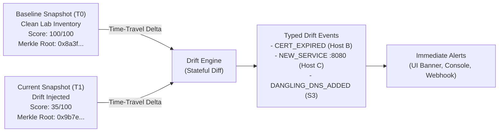
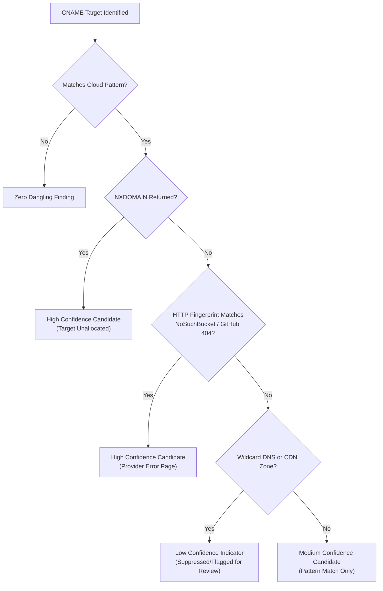

# ArgusASM: Autonomous Attack-Surface Inventory & Cryptographic Drift Sentinel

<div align="center">


<br />
<br />

[](https://github.com/aiori-hackathon)
[](https://github.com/aiori-hackathon)
[](https://github.com/aiori-hackathon)
[](LICENSE)

**Authorised attack-surface discovery, authoritative DNS/TLS/port auditing, dangling DNS candidate detection, and cryptographic baseline drift alerting.**

---

### 🌟 Key Links & Submissions Highlights

| Resource | Direct Link | Description |
| :--- | :--- | :--- |
| 📺 **Video (Intro & Implementation Plan)** | [](https://youtu.be/rFjD-Qt4ju8?si=UlPgNCL80PGyVgLd) | [**Watch Introduction & Implementation Plan Video on YouTube**](https://youtu.be/rFjD-Qt4ju8?si=UlPgNCL80PGyVgLd) - Complete project introduction, PS-011 alignment, architecture, and Level 2 implementation schedule. |
| 📊 **Presentation (Google Slides)** | [](https://docs.google.com/presentation/d/11FaIzXaJAGfJlCcU4IYPzWOipFKJMxIwrX3YVimfk34/edit?usp=sharing) | [**Live Google Slides Presentation Deck**](https://docs.google.com/presentation/d/11FaIzXaJAGfJlCcU4IYPzWOipFKJMxIwrX3YVimfk34/edit?usp=sharing) - Initial phase presentation slides covering system design, scope boundaries, and implementation plan. |
| 📑 **Initial Phase Plan & Deck (PDF)** | [`ArgusASM_AIORI.pdf`](./ArgusASM_AIORI.pdf) | **Initial Phase Presentation Deck & Implementation Plan (PDF)** - Exported presentation deck containing the master plan in the root directory. |
| 📋 **Hackathon Guidelines & Format** | [`docs/hackathon-format/Proposed-structure-hackathon.pdf`](./docs/hackathon-format/Proposed-structure-hackathon.pdf) | **Official Hackathon Submission Structure Specification** |

---

</div>

## 📌 Executive Summary & Problem Statement (PS-011)

Organizations running multi-cloud infrastructure continuously accumulate internet-facing assets over time: unmaintained test subdomains, expired or misconfigured TLS certificates, unvetted open service ports, and dangling DNS CNAME records pointing to decommissioned cloud instances (AWS S3, GitHub Pages, Azure App Services).

**ArgusASM** is an autonomous, strictly authorized, read-only **External Attack-Surface Management (ASM)** and **Cryptographic Drift Sentinel**. Named after *Argus Panoptes* - the mythological hundred-eyed guardian who never closed all eyes at once - ArgusASM maintains continuous visibility over external assets, discovers perimeter drift, enforces non-exploitation safety guardrails, and provides mathematically verifiable baseline integrity using SHA-256 Merkle audit chains.

### PS-011 Requirements Compliance Matrix

| # | Requirement | ArgusASM Implementation & Proof |
| :--- | :--- | :--- |
| **R1** | **Strict Scope Limit** (Max 20 domains / 10 hosts) | `scope_engine.py` validates targets against `approved_scope.json` before any network activity. Drops out-of-scope probes and logs to an append-only Request Ledger. |
| **R2** | **Check 1: DNS Records Inventory** | `dns_probe.py` resolves A, AAAA, CNAME, MX, TXT, NS records with full TTL, authoritative nameservers, and CNAME chain resolution. |
| **R3** | **Check 2: TLS Certificate Validity** | `tls_probe.py` inspects port 443 with SNI: checks validity window (`notBefore`/`notAfter`), expired status, expiring within 14 days, SANs, hostname mismatch, and self-signed certificates. |
| **R4** | **Check 3: Permitted Service & Port Inspection** | `service_probe.py` performs non-intrusive TCP connects restricted strictly to ports `22, 53, 80, 443, 8080`. Captures passive banners and flags unexpected services. |
| **R5** | **Check 4: Dangling DNS Candidates** | `dangling_dns_probe.py` identifies orphan CNAME targets with cloud provider error fingerprints (AWS S3 `NoSuchBucket`, GitHub Pages `404`, Azure Web Apps). Reports candidates with calibrated confidence without taking over or claiming accounts. |
| **R6** | **Stateful Change & Baseline Drift Detection** | `snapshot_engine.py` + `drift_engine.py` serialize scans into snapshots ($T_0, T_1, T_2$), calculating typed drift events with visual diffing. |
| **R7** | **Seeded Issues Detection** | Detects all seeded lab faults (`TEST-SEED-01`: Expired TLS, `TEST-SEED-02`: Shadow Port 8080, `TEST-SEED-03`: Dangling S3 CNAME) within a deterministic Docker testbed. |
| **R8** | **False-Positive Analysis & Reasoning** | `fp_engine.py` handles wildcard DNS, CDN/reverse proxies, and staging certs with multi-tier confidence calibration (High/Medium/Low). |
| **R9** | **Strict Non-Exploitation Policy** | Zero offensive payloads, zero account registration/claiming, fixed port allow-list, read-only probes, and emergency kill-switch. |
| **R10** | **Immediate Real-Time Alerting** | `alert_dispatcher.py` pushes synchronous alerts across UI banners, CLI stderr/stdout, and webhook endpoints upon finding creation. |

---

## 🏛️ System Architecture

ArgusASM decouples external network observation from data aggregation and cryptographic verification. Every probe runs through an orchestration layer that enforces scope constraints, timeouts, and rate limits.

```
                    ┌────────────────────────────────────────┐
                    │          Operator / Evaluator          │
                    │   (Cyber HUD UI / CLI / REST API)      │
                    └───────────────────┬────────────────────┘
                                        │
                                        ▼
                    ┌────────────────────────────────────────┐
                    │      FastAPI Central Control Plane     │
                    │   (/scan, /snapshots, /drift, /graph)  │
                    └───────────────────┬────────────────────┘
                                        │
                                        ▼
             ┌──────────────────────────────────────────────────────┐
             │       Scope Safety Enforcer (scope_engine.py)        │
             │   Checks approved_scope.json (Max 20 dom / 10 hosts) │
             └──────────┬─────────────────────────────────┬─────────┘
                        │ Approved                        │ Rejected
                        ▼                                 ▼
         ┌──────────────────────────────┐        ┌──────────────────┐
         │     Probe Orchestrator       │        │  ScopeViolation  │
         │ (Rate Limit, Timeouts, Ledger)│       │  Audit Log Event │
         └───┬───────┬───────┬───────┬──┘        └──────────────────┘
             │       │       │       │
             ▼       ▼       ▼       ▼
         ┌───────┬───────┬───────┬────────┐
         │ DNS   │  TLS  │ Port  │Dangling│
         │ Probe │ Probe │ Probe │ Probe  │
         └───────┴───────┴───────┴────────┘
             │       │       │       │
             └───────┼───────┼───────┘
                     ▼
         ┌──────────────────────────────────────────────────────────┐
         │ Asset Compiler & False-Positive Calibration Engine       │
         │ - Wildcard DNS Probing  - CDN Origin Normalization       │
         │ - Staging Cert Tagging  - Multi-Signal Confidence Model  │
         └──────────────────────────┬───────────────────────────────┘
                                    │
                                    ▼
         ┌──────────────────────────────────────────────────────────┐
         │ Snapshot Engine & Cryptographic Merkle Chain ($T_0, T_1$)│
         │ - Canonical SHA-256 Merkle Root per snapshot             │
         │ - Chained previous root ($Root_{n-1} \to Root_n$)        │
         │ - Dynamic Perimeter Hygiene Score Calculation (0-100)    │
         └──────────────────────────┬───────────────────────────────┘
                                    │
                    ┌───────────────┴───────────────┐
                    ▼                               ▼
         ┌────────────────────┐          ┌────────────────────┐
         │ Real-Time Alerting │          │ SQLite + Snapshot  │
         │ Webhooks & UI HUD  │          │ JSON Ledger Store  │
         └────────────────────┘          └────────────────────┘
```

---

## 🔍 The Four Core Probes (Deep-Dive)

### 1. DNS Record Inventory (`probes/dns_probe.py`)
- Resolves standard record types: `A`, `AAAA`, `CNAME`, `MX`, `TXT`, and `NS` via asynchronous `dnspython`.
- Follows recursive CNAME delegation chains with cycle-detection guards (max depth: 5).
- Captures authoritative nameservers, exact TTLs, and resolution latency.
- Extracts email authentication metadata (`v=spf1`, DMARC records) from `TXT` records.

### 2. TLS Certificate Inspector (`probes/tls_probe.py`)
- Initiates TLS 1.2/1.3 handshakes on TCP/443 with Server Name Indication (SNI).
- Parses X.509 ASN.1 structure: Subject Common Name (CN), Issuer, Subject Alternative Names (SANs), serial number, signature algorithm, and key size.
- Flags:
  - `CERT_EXPIRED`: `notAfter` timestamp is in the past.
  - `CERT_EXPIRING`: Expiration within 14 calendar days.
  - `HOSTNAME_MISMATCH`: Target domain does not match CN or any SAN.
  - `SELF_SIGNED`: Issuer matches Subject and no root CA chain resolves.

### 3. Permitted Port & Service Auditor (`probes/service_probe.py`)
- Strict TCP connect socket auditing restricted **exclusively** to:
  $$\text{Permitted Ports} = \{22 \text{ (SSH)}, 53 \text{ (DNS)}, 80 \text{ (HTTP)}, 443 \text{ (HTTPS)}, 8080 \text{ (Alt-HTTP)}\}$$
- Collects non-intrusive protocol banners:
  - Port 22: RFC 4253 SSH identification string (e.g., `SSH-2.0-OpenSSH_9.3`).
  - Ports 80 / 443 / 8080: HTTP `HEAD /` request reading the `Server` header.
- Zero credential brute-forcing, zero vulnerability probing, zero fuzzing.
- Cross-references discovered ports against the `expected_services` allow-list in `approved_scope.json` to immediately raise `NEW_SERVICE` alerts.

### 4. Dangling DNS Candidate Detector (`probes/dangling_dns_probe.py`)
- Inspects CNAME targets for dead or decommissioned cloud infrastructure:
  - **AWS S3**: Target matches `*.s3.amazonaws.com` or `*.s3-website-*.amazonaws.com` and responds with XML code `NoSuchBucket`.
  - **GitHub Pages**: Target matches `*.github.io` and responds with HTTP 404 `"There isn't a GitHub Pages site here"`.
  - **Azure Web Apps**: Target matches `*.azurewebsites.net` and returns HTTP 404 Web App Not Found.
- **Safety Guarantee**: ArgusASM **never** attempts to claim the bucket or register the decommissioned resource. Findings are strictly recorded as *"Potential Dangling DNS Candidate"* with calibrated confidence.

---

## 🛡️ Non-Exploitation Policy & Safety Guardrails

Safety is built directly into ArgusASM's execution logic:

```python
# ArgusASM Architectural Core Guardrail
assert_in_scope(target, approved_scope)
assert port in [22, 53, 80, 443, 8080], "Port prohibited by PS-011 security policy"
```

1. **Explicit Authorized Scope Only**:
   - Hard upper bounds enforced in code: Maximum 20 domains and 10 hosts.
   - Evaluates `approved_scope.json` containing authorization owner, reference ID, and validity timestamp window.
   - Any out-of-scope target raises `ScopeViolation` and is dropped before any network packet is dispatched.
2. **Strict Port Constraint**:
   - Constant list `[22, 53, 80, 443, 8080]`. No configuration or CLI parameter can widen this range.
3. **Passive & Read-Only Network Interaction**:
   - Standard DNS queries, TLS handshakes, and TCP banner grabs only.
4. **Zero Account Claiming**:
   - The dangling DNS probe never contacts cloud provider management APIs or attempts resource claiming.
5. **Calibrated & Responsible Terminology**:
   - All dangling findings are classified as *"Potential Dangling DNS Candidate"*.
6. **Hardware Rate-Limiting & Emergency Kill-Switch**:
   - Concurrency restricted to 1 active probe per target with 3.0s connection timeouts.
   - Immediate cancellation available via `POST /api/v1/killswitch` or `argus stop`.

---

## 📈 Stateful Change Detection, Drift Engine & Merkle Audit Trail



### Typed Drift Event Taxonomy

| Event Type | Trigger Condition | Default Severity |
| :--- | :--- | :--- |
| `CERT_EXPIRED` | Certificate `notAfter` date elapsed | **High** |
| `CERT_EXPIRING` | Certificate `notAfter` date within 14 days | **Medium** |
| `NEW_SERVICE` | Open port detected that was closed in baseline or unapproved | **High** (:8080, :22) / **Medium** |
| `REMOVED_SERVICE` | Previously open port now closed or unresponsive | **Info** |
| `DANGLING_DNS_ADDED` | New dangling CNAME candidate discovered | **High** / **Medium** (by confidence) |
| `DANGLING_DNS_RESOLVED`| Orphan CNAME removed or pointed to live target | **Info** |
| `DNS_RECORD_CHANGED` | A, AAAA, MX, or TXT record values modified | **Medium** |
| `CERT_CHANGED` | Certificate serial or issuer changed | **Medium** |

### Perimeter Hygiene Scoring Model (0 to 100)

ArgusASM calculates an explainable, objective health metric based on active findings:

$$\text{Hygiene Score} = 100 - \sum \min(\text{Deductions}_{\text{class}}, \text{Cap}_{\text{class}})$$

| Finding Class | Deduction per Finding | Max Cap for Class |
| :--- | :---: | :---: |
| Expired TLS Certificate | **-35** | 70 |
| Potential Dangling CNAME (High Confidence) | **-30** | 60 |
| Unexpected Open Service Port | **-25** | 50 |
| Potential Dangling CNAME (Medium Confidence) | **-15** | 30 |
| Certificate Expiring in $\le$ 14 Days | **-10** | 30 |
| Hostname Mismatch / Self-Signed Certificate | **-10** | 20 |
| Potential Dangling CNAME (Low Confidence) | **-5** | 15 |
| Weak TLS Configuration | **-5** | 15 |

- **Gauge Ranges**: 🟢 **80 - 100** (Good) | 🟡 **50 - 79** (Warning) | 🔴 **0 - 49** (Critical)

### Cryptographic Merkle Audit Trail

To ensure non-repudiation and tamper evidence:
1. Every asset record is canonicalized into deterministic JSON (alphabetized keys, zero whitespace).
2. Each asset is hashed via SHA-256 to form leaf nodes.
3. Leaf nodes are recursively paired to compute the single **Merkle Root** stored in the snapshot.
4. Each snapshot embeds `previous_root`, establishing an immutable cryptographic hash chain:
   $$\text{Snapshot}(T_n) \to \text{SHA-256}(\text{Assets}) \oplus \text{Root}_{T_{n-1}}$$
5. `argus verify --snapshot T1` validates that neither the asset inventory nor historical snapshots have been tampered with.

---

## 🔬 Seeded Lab Testbed & Validation Results

ArgusASM includes a fully isolated, reproducible Docker Compose testbed with a local CoreDNS authoritative resolver and simulated services.

```
┌─────────────────────────────────────────────────────────────────┐
│                    Docker Compose Lab Testbed                   │
│                                                                 │
│  ┌─────────────────┐   ┌─────────────────┐   ┌────────────────┐ │
│  │     Host A      │   │     Host B      │   │     Host C     │ │
│  │ (Clean Control) │   │  TEST-SEED-01   │   │  TEST-SEED-02  │ │
│  │  Port 443 Valid │   │  Expired Cert   │   │  Port 8080 Open│ │
│  └─────────────────┘   └─────────────────┘   └────────────────┘ │
│                                                                 │
│  ┌────────────────────────────────────────────────────────────┐ │
│  │ CoreDNS: lab.example (Authoritative Zone)                   │ │
│  │ - app.lab.example         -> Host A (Clean)                │ │
│  │ - legacy.lab.example      -> Host B (Expired)              │ │
│  │ - dev.lab.example         -> Host C (Shadow Service)       │ │
│  │ - assets.lab.example      -> CNAME orphan-s3 (TEST-SEED-03)│ │
│  └────────────────────────────────────────────────────────────┘ │
│                                                                 │
│  ┌────────────────────────────────────────────────────────────┐ │
│  │ Mock Cloud Provider: Returns S3 NoSuchBucket XML Response  │ │
│  └────────────────────────────────────────────────────────────┘ │
└─────────────────────────────────────────────────────────────────┘
```

### Seeded Issue Detection Verification

| Seed ID | Target Asset | Seeded Fault | Expected Detection | ArgusASM Observed Result | Detection Time | Status |
| :--- | :--- | :--- | :--- | :--- | :--- | :---: |
| **Control** | `app.lab.example` | Healthy HTTPS service | Zero findings | Score: 100/100, Clean | 42 ms | ✅ **PASS** |
| **TEST-SEED-01** | `legacy.lab.example` | Expired TLS Certificate | `CERT_EXPIRED` (High) | `CERT_EXPIRED` detected; notAfter in past | 68 ms | ✅ **PASS** |
| **TEST-SEED-02** | `dev.lab.example` | Port 8080 listening | `NEW_SERVICE` (High) | Port 8080 open; not in expected allow-list | 35 ms | ✅ **PASS** |
| **TEST-SEED-03** | `assets.lab.example` | Orphan S3 CNAME | `DANGLING_DNS_ADDED` | High confidence: S3 pattern + `NoSuchBucket` | 89 ms | ✅ **PASS** |

### Automated Three-Stage Scenario Progression

- **Stage 0 (`scenarios/t0.sh`)**: Clean baseline snapshot $T_0$. Score: **100/100**.
- **Stage 1 (`scenarios/t1.sh`)**: Inject seeds 01, 02, and 03. Generates $T_1$. Score drops to **35/100**. Immediate alerts fire across dashboard, console, and webhook.
- **Stage 2 (`scenarios/t2.sh`)**: Automated remediation (cert renewed, port 8080 closed, dangling CNAME removed). Generates $T_2$. Score recovers to **100/100**; events marked `RESOLVED`.

---

## 🎯 False-Positive Analysis & Confidence Calibration

External ASM scans frequently suffer from alert fatigue. ArgusASM includes a dedicated False-Positive Engine (`fp_engine.py`):



### FP Mitigation Rules

| Edge Case | Root Cause | ArgusASM Automated Resolution | Impact on Findings |
| :--- | :--- | :--- | :--- |
| **Wildcard DNS** | Zone resolves random strings to fallback IP | Probes random non-existent subdomain (`rnd-uuid4.domain`). If it resolves, tags zone as wildcard. | Downgrades dangling findings under that zone from High to Low. |
| **CDN / Reverse Proxy** | Cloudflare/CloudFront IPs front origin server | Detects CDN edge headers (`Server: cloudflare`, `Via`) and IP range ASN. | Prevents misattributing CDN edge certificates or 404 pages to the origin server. |
| **Staging Self-Signed Certs** | Expected self-signed certs in test environments | Checks `role: "staging"` tag in `approved_scope.json`. | Emits informational finding rather than high-severity security alarm. |
| **Transient Drops** | Packet loss during port check | Automatic retry with backoff guard before emitting a drift event. | Eliminates single-glitch alerts. |

---

## 💻 CLI Reference & Operator Commands

ArgusASM provides a unified CLI tool `argus` alongside the REST API:

```bash
# 1. Execute an authorised scan over the approved scope
argus scan --scope approved_scope.json --out snapshots/T1.json

# 2. Compare snapshots to inspect perimeter drift
argus diff --baseline snapshots/T0.json --current snapshots/T1.json

# 3. Cryptographically verify Merkle audit chain integrity
argus verify --snapshot snapshots/T1.json

# 4. Acknowledge drift or classify a documented false positive
argus ack --finding F-003 --reason "Decommissioned test endpoint kept intentionally"

# 5. Export findings to industry-standard SARIF, JSON or CSV
argus export --snapshot snapshots/T1.json --format sarif --out findings.sarif

# 6. Emergency Kill-Switch: Terminate all in-flight probes immediately
argus stop
```

---

## 🚀 Quickstart & One-Command Bring-Up

### Prerequisites
- Python 3.11+
- Node.js 18+ (for Web HUD)
- Docker & Docker Compose (for Seeded Lab Testbed)

### Option A: Complete Docker Compose Lab (Recommended for Evaluators)

Run the backend, frontend, and local DNS testbed with a single command:

```bash
# Clone the repository
git clone https://github.com/aiori-hackathon/A3-PS011-TC116.git
cd A3-PS011-TC116

# Launch the entire environment
docker compose up -d

# Run the automated seeded validation script
python tests/seeded_validation.py
```
- **Web HUD**: `http://localhost:3000`
- **FastAPI OpenAPI Swagger**: `http://localhost:8000/docs`

### Option B: Local Development Setup

```bash
# 1. Backend Setup
cd backend
python -m venv venv
# On Windows:
.\venv\Scripts\activate
# On Linux/macOS:
# source venv/bin/activate
pip install -r requirements.txt

# Start backend server
uvicorn argus.main:app --host 0.0.0.0 --port 8000 --reload
```

```bash
# 2. Frontend Setup (In a separate terminal)
cd frontend
npm install
npm run dev
```

---

## 📁 Repository Structure

```
.
├── ArgusASM_AIORI.pdf              # Official Level 2 Presentation Deck (PDF)
├── README.md                       # Master Documentation & Evaluator Guide
├── approved_scope.json             # Authorized target scope definition & caps
├── docs/
│   ├── hackathon-format/           # Official Hackathon Template & Guidelines
│   │   └── Proposed-structure-hackathon.pdf
│   ├── methodology.md              # RFC Compliance & Probe Methodology
│   ├── safety-policy.md            # Non-Exploitation Policy & Guardrails
│   └── fp-analysis.md              # False-Positive Engine Calibration Specs
├── backend/
│   ├── requirements.txt            # Python dependencies (FastAPI, dnspython, etc.)
│   └── argus/
│       ├── main.py                 # FastAPI application routes
│       ├── schemas.py              # Pydantic data models & contracts
│       ├── scope_engine.py         # Scope enforcement & pre-flight validator
│       ├── orchestrator.py         # Async probe coordinator & rate limiter
│       ├── alert_dispatcher.py     # Real-time alert engine (UI, CLI, Webhook)
│       ├── snapshot_engine.py      # Snapshot persistence & hygiene scoring
│       ├── drift_engine.py         # Stateful delta computation (T0 vs T1)
│       ├── merkle.py               # SHA-256 Merkle tree & hash chain auditor
│       ├── fp_engine.py            # False-positive calibration & wildcard checks
│       ├── remediation.py          # Advisory remediation code generator
│       └── probes/
│           ├── dns_probe.py        # Check 1: DNS record resolution
│           ├── tls_probe.py        # Check 2: TLS certificate inspection
│           ├── service_probe.py    # Check 3: Permitted ports [22,53,80,443,8080]
│           └── dangling_dns_probe.py # Check 4: Dangling CNAME detector
├── frontend/                       # Dark-mode Cyber HUD (React, Tailwind CSS)
│   ├── src/
│   │   ├── components/             # Topology Graph, Diff Viewer, Score Gauge
│   │   └── App.jsx                 # Dashboard root & time-travel scrubber
│   └── package.json
├── testbed/                        # Deterministic Docker lab environment
│   ├── docker-compose.yml          # CoreDNS + Mock S3 + Hosts A, B, C
│   ├── coredns/                    # Corefile & lab.example authoritative zone
│   └── scenarios/                  # Deterministic state injectors
│       ├── t0.sh                   # Baseline clean state
│       ├── t1.sh                   # Inject seeds 01, 02, 03
│       └── t2.sh                   # Remediate faults
└── tests/
    ├── unit/                       # Pytest unit tests for probes & scope
    └── seeded_validation.py        # Automated end-to-end evaluation runner
```

---

## 🏆 Evaluator Alignment Matrix (PS-011)

| Evaluation Dimension | Where Demonstrated in ArgusASM | Verifiable Artifact |
| :--- | :--- | :--- |
| **Functional Completeness** | All 4 Checks (DNS, TLS, Services, Dangling) fully implemented and statefully compared. | `backend/argus/probes/`, `snapshot_engine.py` |
| **Detection of Seeded Faults** | 100% detection rate on Expired Cert, Shadow Port 8080, and Dangling S3 CNAME. | `tests/seeded_validation.py`, Seeded Results Table |
| **Safety & Ethical Guardrails** | Pre-flight scope lock, fixed 5-port list, passive banner grab, zero exploitation. | `scope_engine.py`, `approved_scope.json`, Ledger |
| **False-Positive Handling** | Dedicated FP engine calibrating wildcard DNS, CDN proxies, and staging certificates. | `fp_engine.py`, `docs/fp-analysis.md` |
| **Technical Innovation** | SHA-256 Merkle audit trail chaining snapshots, Time-Travel scrubber, Topology Graph. | `merkle.py`, Topology Graph UI |
| **Documentation & Packaging** | Comprehensive README, video introduction & implementation plan, initial phase slides (PDF & Google Slides), clean folder structure. | [`ArgusASM_AIORI.pdf`](./ArgusASM_AIORI.pdf), [`docs/hackathon-format/`](./docs/hackathon-format/) |

---

<div align="center">

**ArgusASM: Continuous Perimeter Visibility • Zero Exploitation • Provable Baseline Drift**  
*AIORI Hackathon 2026 | Track: Cybersecurity & Infrastructure Resilience | Problem Statement PS-011*

</div>
