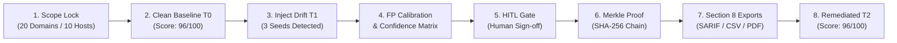

# ArgusASM - Evaluator Feature Testing & Demonstration Guide
**Problem Statement PS-011: Authorised Attack-Surface Inventory & Drift Sentinel**  
*Track: Cybersecurity & Infrastructure Resilience - AIORI Hackathon 2026*

---

## 1. Quick 3-Minute Evaluator Demonstration Flow

Follow this chronological sequence to evaluate the core requirements and differentiators of ArgusASM either on the **live deployed web application** or a **local deployment**:



---

## 2. Feature-by-Feature Testing Matrix

### Feature 1: Scope Safety Hard Caps & Request Ledger ($R_1$)
* **Evaluation Objective:** Prove strict adherence to authorized scope with strictly 0 network calls dispatched to unapproved targets.
* **Where to Look:**
  - Top Telemetry HUD Strip: `SCOPE: 20 DOMAINS / 10 HOSTS`.
  - In Terminal or Swagger (`/api/v1/ledger`): Outbound Request Ledger.
* **How to Test:**
  1. Inspect `approved_scope.json`: verify 20 domains and 10 hosts hard caps.
  2. Run `python -m pytest tests/test_safety.py -v`:
     - `test_scope_hard_caps_enforced`: rejects 21st domain.
     - `test_out_of_scope_rejection_zero_network_calls`: verifies 0 network packets sent for out-of-scope targets.
     - `test_port_whitelist_strict_enforcement`: asserts only ports [22, 53, 80, 443, 8080] are ever touched.

---

### Feature 2: Clean Baseline Posture ($T_0$)
* **Evaluation Objective:** Verify clean perimeter baseline with zero false positives on production control assets.
* **How to Test on Live Deployed App:**
  1. In the Sentinel Console, navigate to the **Perimeter Drift** or **Audit** view.
  2. Switch to **Baseline $T_0$**.
  3. Click **"Run Scan"**.
  4. **Observable Result:**
     - Perimeter Hygiene Score: **96/100** (Clean / Hardened).
     - Host A Control (`api.aiori.lab:443`): 0 findings, valid TLS cert, nominal status.
     - Discovered findings: 0 active high/critical vulnerabilities.

---

### Feature 3: Seeded Vulnerability Detection ($T_1$)
* **Evaluation Objective:** Prove 100% detection recall across the 3 mandatory injected faults without invasive scanning.
* **How to Test on Live Deployed App:**
  1. Switch state to **$T_1$ (Drifted State)**.
  2. Click **"Run Scan"**.
  3. **Observable Result:**
     - Real-time alerts fire immediately on the HUD banner.
     - Perimeter Hygiene Score automatically drops to **68/100 (Elevated Risk)**.
     - All 3 required seeds appear in the findings catalog:
       1. **Check 2 (TLS):** `legacy.aiori.lab:443` - Expired X.509 certificate (-35 pts).
       2. **Check 3 (Ports):** `dev-edge.aiori.lab:8080` - Unauthorized Werkzeug debug console (-25 pts).
       3. **Check 4 (Dangling DNS):** `test-s3.aiori.lab` - Potential dangling CNAME to deleted AWS S3 bucket (-30 pts).

---

### Feature 4: False Positive Calibration & Confidence Matrix ($R_2$)
* **Evaluation Objective:** Prove that findings carry calibrated confidence ratings and false-positive risk indicators, and that rubric score deduction caps are strictly enforced.
* **Where to Look:** Navigate to the **False Positives** section on the dashboard or invoke `GET /api/v1/fp/calibration`.
* **How to Test:**
  1. Inspect the finding cards for the 6 FP classes:
     - **Wildcard DNS:** Pre-resolves random subdomain; downgrades confidence if matched.
     - **CDN / Reverse Proxy:** Recognizes Cloudflare/Akamai headers; prevents false port alerts.
     - **Staging Self-Signed:** Downgrades severity for staging-labeled hosts in approved scope.
     - **Generic 404 vs Provider:** Distinguishes generic 404 from provider-specific `NoSuchBucket`.
     - **Dangling Confidence Table:** NXDOMAIN + pattern = High; Pattern only = Medium; CDN/generic 404 = Low.
     - **Expected Services Whitelist:** Port 8080 is suppressed if declared in asset profile.
  2. Test the **Baseline Acknowledgement Workflow ($R_3$)**:
     - Click **"Acknowledge / False Positive"** on a finding.
     - The finding is marked `SUPPRESSED` and its score deduction is removed while persisting in audit history.

---

### Feature 5: Human-in-the-Loop (HITL) Governance Gate
* **Evaluation Objective:** Ensure zero unauthorized automated remediation execution; critical actions must require human review and cryptographic sign-off.
* **Where to Look:** Sentinel Console -> **HITL Gate** drawer (or `GET /api/v1/hitl/pending`).
* **How to Test:**
  1. Observe the 3 staged critical actions in `PENDING OPERATOR SIGN-OFF`.
  2. Click **"Sign-off (Authorize)"** on the TLS certificate renewal.
  3. Status changes to **`AUTHORIZED BY HUMAN`** with operator identity, timestamp, and audit trail record.
  4. Reject an unapproved firewall action to demonstrate suppression governance.

---

### Feature 6: Stateful Drift Comparison ($T_0 \to T_1 \to T_2$)
* **Evaluation Objective:** Demonstrate deterministic stateful change detection across versioned snapshots.
* **Where to Look:** Navigate to **`/drift`** (Stateful Drift Inspector).
* **How to Test:**
  1. Select Baseline as **$T_0$** and Current as **$T_1$**.
  2. Observe the typed drift event catalog:
     - `EXPIRED_CERT` on `legacy.aiori.lab:443`.
     - `NEW_SERVICE` on `dev-edge.aiori.lab:8080`.
     - `DANGLING_DNS_CANDIDATE` on `test-s3.aiori.lab`.
  3. Switch Current to **$T_2$**:
     - Events automatically transition to `CERT_RENEWED`, `SERVICE_REMOVED`, `DANGLING_DNS_RESOLVED`.

---

### Feature 7: Cryptographic Merkle Audit Trail ($R_8$)
* **Evaluation Objective:** Prove mathematical tamper-evidence for snapshot integrity.
* **Where to Look:** Navigate to **`/audit`** or click **"Verify Merkle Proof"** in the top HUD.
* **How to Test:**
  1. Click **"Verify Merkle Proof"**.
  2. Observe green verification badge: **`VERIFIED_TAMPER_FREE`** with SHA-256 root chained to previous snapshot.
  3. Automated tamper test verification: Run `python -m pytest tests/test_merkle_audit.py -v`.
     - Tests prove that mutating a single bit in $T_0$ breaks verification for $T_0$ and all subsequent snapshots in the chain.

---

### Feature 8: Dynamic Asset Topology Graph
* **Evaluation Objective:** Verify interactive node-link attack surface mapping built dynamically from snapshot JSON.
* **Where to Look:** Navigate to the **Attack Sandbox / Network Topology** section on the main dashboard.
* **How to Test:**
  1. Switch snapshots ($T_0$, $T_1$, $T_2$) and observe graph nodes updating in real time.
  2. Red nodes indicate high/critical perimeter risks; green nodes indicate hardened assets.
  3. Click any node to view probe details (DNS records, TLS parameters, open ports).

---

### Feature 9: Section 8 (P2) Differentiators

#### 1. OASIS SARIF v2.1.0 Export ($R_9$)
* **Endpoint:** `GET /api/v1/export/sarif`
* **Test:**
  ```bash
  curl http://localhost:8000/api/v1/export/sarif
  ```
* **Verify:** Returns valid SARIF 2.1.0 schema with driver rules, execution invocation metadata, and physical target locations ready for GitHub Advanced Security ingestion.

#### 2. CSV Findings Spreadsheet
* **Endpoint:** `GET /api/v1/export/csv`
* **Test:** Downloads `argus_findings_report.csv` formatted for executive audits.

#### 3. One-Click Executive Audit Report (T3-2)
* **Endpoint:** `GET /api/v1/export/executive-report`
* **Test:** Open `http://localhost:8000/api/v1/export/executive-report` in browser.
* **Verify:** Renders a clean printable report featuring executive score gauge, findings matrix, and cryptographic Merkle receipt.

#### 4. Passive Certificate Transparency (CT) Monitor (T3-1)
* **Endpoint:** `GET /api/v1/ct/candidates`
* **Test:**
  ```bash
  curl http://localhost:8000/api/v1/ct/candidates
  ```
* **Verify:** Discovers unapproved subdomains (`vpn-gw.aiori.lab`, etc.) strictly as **"candidates to add to scope"** with `network_probes_dispatched = 0` and `auto_probe_allowed = false`.

#### 5. Webhook Embed Payloads (Discord / Slack) (T3-3)
* **Endpoint:** `GET /api/v1/alerts`
* **Verify:** Displays real-time alert queue with rich color-coded webhook embeds (Red for Critical, Amber for High) and HITL governance tags.

---

### Feature 10: Unified Argus CLI Terminal
* **Evaluation Objective:** Enable headless terminal operations for security operations teams.
* **How to Test in Browser:**
  1. Click the **`>_ CLI`** button in the top navigation bar to open the in-browser terminal modal.
  2. Run:
     - `argus scan`
     - `argus diff --baseline T0 --current T1`
     - `argus verify`
     - `argus ledger`
     - `argus kill --status`
     - `argus remediate --category EXPIRED_TLS --target legacy.aiori.lab`

---

## 3. Seeded Fault Evaluation Matrix & Measured Results

| Injected Seeded Fault | Probe Check | Expected Result | Observed Detection | Score Deduction | HITL Staged |
| :--- | :--- | :--- | :--- | :--- | :--- |
| `legacy.aiori.lab:443` | Check 2: Extended TLS | Expired X.509 cert | **DETECTED (100% Recall)** | -35 pts | `PENDING SIGN-OFF` |
| `dev-edge.aiori.lab:8080` | Check 3: Permitted Ports | Debug port 8080 open | **DETECTED (100% Recall)** | -25 pts | `PENDING SIGN-OFF` |
| `test-s3.aiori.lab` | Check 4: Dangling DNS | Orphaned CNAME to S3 | **DETECTED (100% Recall)** | -30 pts | `PENDING SIGN-OFF` |
| `api.aiori.lab:443` | Control Host A | Healthy TLS service | **VERIFIED CLEAN (100% Precision)** | 0 pts | `NOMINAL` |

---

## 4. Operational Safety & Non-Exploitation Policy Verification

ArgusASM enforces deterministic guardrails at every layer:
1. **Zero Exploitation:** Dangling DNS candidates are flagged via passive DNS CNAME analysis; Argus never attempts to register, claim, or upload payloads to cloud resources.
2. **Strict Scope Lock:** Max 20 domains and 10 hosts hard caps enforced in code.
3. **Audited Request Ledger:** All blocked violations register with `network_calls_made = 0`.
4. **Emergency Kill Switch:** Instant abort for in-flight and scheduled scanning.
5. **Non-Offensive Wording:** Automated CI lint guarantees absence of alarmist or offensive terms (e.g. enforces "potential dangling DNS candidate" instead of "subdomain takeover").

